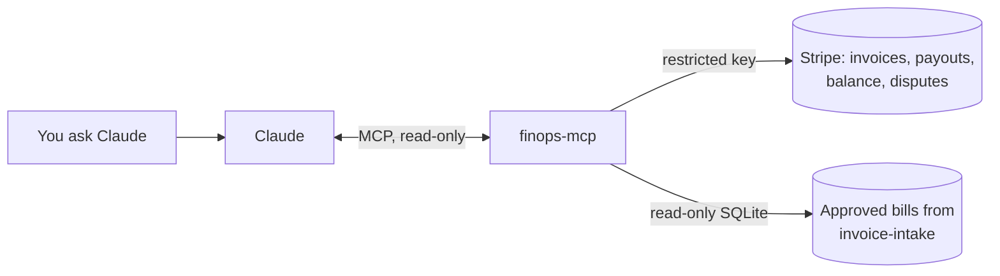

# finops-mcp

**Ask Claude about your money, in plain English, from your real Stripe data.** "Who owes us money and how late are they?" "What's in Friday's payout?" "Do we have enough cash to cover rent and payroll in the next two weeks?"

`finops-mcp` is a [Model Context Protocol](https://modelcontextprotocol.io) server that gives Claude (Desktop, Claude Code, or any MCP client) eight **read-only** finance tools over Stripe and your supplier bills. It cannot create, refund, pay or change anything.



## Tools

| Tool | Answers |
|---|---|
| `receivables` | Open customer invoices, days overdue, aging buckets (current, 1-30, 31-60, 61-90, 90+), totals per currency |
| `invoice_detail` | One invoice: lines, totals, payment attempts, hosted link |
| `payouts` | Recent payouts to the bank, arrival date and status |
| `payout_breakdown` | What one payout is made of: sales, refunds, chargebacks, fees, mapped to journal accounts, and a check that the lines add up to the amount that hit the bank |
| `disputes` | Open chargebacks with the evidence deadline and days left |
| `payables` | Approved, unpaid supplier bills due in the next N days |
| `balance` | Stripe available and pending, per currency |
| `cash_forecast` | Day-by-day cash for one currency: lowest point, first day it goes negative, overdue invoices at risk, and the assumptions behind it |

There is also a `weekly_cash_review` prompt: one click in Claude Desktop runs the Monday check-in (overdue customers to chase, bills due, disputes due this week, cash low point).

Money is exact: amounts are decimals in major units, zero-decimal currencies (JPY, VND, KRW...) are handled, nothing goes through floats.

## Try it in two minutes (no Stripe account needed)

Demo mode serves a small fictional business: five open invoices (two overdue), three payouts, one chargeback, five bills.

```bash
pip install git+https://github.com/TylerNguyennn/finops-mcp
```

Add it to Claude Desktop (`Settings → Developer → Edit Config`, file `claude_desktop_config.json`):

```json
{
  "mcpServers": {
    "finops": {
      "command": "finops-mcp",
      "env": { "FINOPS_DEMO": "1" }
    }
  }
}
```

Or to Claude Code:

```bash
claude mcp add finops --env FINOPS_DEMO=1 -- finops-mcp
```

Then ask: *"Run a 13-day cash forecast. When do we go negative, and what would fix it?"*

This is what the `cash_forecast` tool returns in demo mode (abridged):

```
opening   4,312.40 USD   (Stripe available; no bank balance given)
Oct 29   +4,605.10   8,917.50   Stripe pending settles; payout po_demo_3 lands
Oct 30   -7,500.00   1,417.50   bill RENT-NOV to Riverside Property Management
Oct 31     -285.00   1,132.50   bill INV-2041 to Acme Cloud Hosting LLC
Nov 01     +980.00   2,112.50   invoice HB-1003 from Lumen Studio
Nov 04   -3,900.00  -1,787.50   bill CP-2026-11A to Crewline Contractor Payroll   <- first negative
Nov 05   -1,250.00  -3,037.50   bill VA-7781 to Vector Ads Ltd                     <- lowest
Nov 08   +6,200.00   3,162.50   invoice HB-1004 from Atlas Fitness Group
at risk: HB-1001 Harbor Coffee Roasters 1,200.00 (10 days late), HB-1002 Pinecrest Dental 3,450.00 (20 days late)
```

The answer is in the data: collect the two overdue invoices (4,650.00) and cash never goes below zero. The test suite checks exactly that.

## Use it with your Stripe account

1. In Stripe, create a **restricted key** (Developers → API keys → Create restricted key) with **Read** on: Invoices, Payouts, Balance, Balance transactions, Disputes. Everything else: None.
2. Configure the server:

```json
{
  "mcpServers": {
    "finops": {
      "command": "finops-mcp",
      "env": {
        "STRIPE_API_KEY": "rk_live_...",
        "FINOPS_BILLS_DB": "/path/to/invoice-intake/data/register.sqlite"
      }
    }
  }
}
```

| Variable | Meaning |
|---|---|
| `STRIPE_API_KEY` | Restricted read-only key. A full `sk_live_` key works but prints a warning. |
| `FINOPS_BILLS_DB` | Optional. The register from [invoice-intake](https://github.com/TylerNguyennn/invoice-intake): approved and exported bills that are not marked paid. Without it, `payables` explains how to set it and the forecast has no outgoing bills. |
| `FINOPS_DEFAULT_TERMS_DAYS` | Payment terms for bills with no printed due date (default 30). |
| `FINOPS_DEMO=1` | The fictional demo data above. |

## Safety

- **Read-only by construction.** The code only calls Stripe `list` and `retrieve` endpoints; the restricted key makes that a guarantee on Stripe's side too. The bills register is opened with SQLite `mode=ro`. Every tool carries the MCP `readOnlyHint` annotation, so clients know none of them change anything.
- **Your data goes where your MCP client sends it.** Tool results go to the Claude client you connected (for Claude Desktop, that means Anthropic's API). Nothing else leaves your machine; the server has no telemetry.
- **Keys live in your client config or environment,** never in this repo.

## How the forecast works (and what it leaves out)

Opening cash = the bank balance you pass (`opening_bank_balance`, default 0) + Stripe available. Stripe pending is counted `pending_settles_in_days` after today (default 2). Payouts already in transit land on their arrival date. Open invoices are paid on their due date; overdue ones are left out and listed as at risk unless you pass `include_overdue_receivables`. Approved bills are paid on their due date. New card sales, payroll and spending outside the bills register are not included. The tool returns these assumptions with every forecast so Claude repeats them.

## Development

```bash
pip install -e ".[dev]"
pytest -q
```

The tests drive the server through a real MCP client in-process and check the numbers above, the Stripe SDK field mapping (with fake SDK objects, no network), the read-only bills register and error messages that reach the model.

```
finops_mcp/
  sources.py    Stripe and bills-register readers (+ demo versions), all amounts as Decimal
  server.py     the MCP tools, prompt, and env configuration
  demo/         fictional data; dates are offsets from today so the demo never ages
tests/
```

## Part of a small finance-ops toolkit

- [stripe-payout-reconcile](https://github.com/TylerNguyennn/stripe-payout-reconcile): split Stripe payouts into journal lines and match them to the bank statement.
- [invoice-intake](https://github.com/TylerNguyennn/invoice-intake): supplier invoices from a mailbox, read by Claude, checked, approved, exported to Xero or QuickBooks.
- [finops-mcp](https://github.com/TylerNguyennn/finops-mcp): ask Claude about receivables, payouts, disputes, bills and cash, read-only over Stripe.

## Want this for your business?

I build payment and finance-ops automation: PSP integrations, webhooks, payouts, reconciliation, and Claude-based tools like this one. I can add your bank feed, Xero or QuickBooks, multi-entity or multi-currency reporting, and alerts to Slack, and deploy it for your team.

Get in touch through [taewoo.me](https://taewoo.me).

## License

MIT
